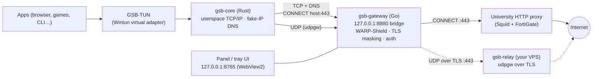

# GSB Wi-Fi Proxy Launcher

A Windows tray app that routes a PC's traffic through a **university HTTP proxy**
on a filtered campus/dorm (GSB/KYK) Wi-Fi, using the user's **own** proxy account.
It brings up a virtual network adapter (**GSB-TUN**) so that all **TCP** and **DNS**
— and optionally **UDP** via a self-hosted relay — flow through one secure tunnel,
instead of only a browser's HTTP proxy setting.

> ⚠️ **Disclaimer.** This is a personal tool, for use with your **own** university
> account and your **own** server. Bypassing network filters/restrictions, defeating
> DPI, or hiding traffic may violate the relevant institution's Acceptable Use Policy
> and can lead to account suspension or disciplinary action. Enabling the
> spoofing/tunneling features is entirely at the user's discretion and risk. It does
> **not** cover someone else's accounts or any unauthorized access.

---

## How it works

The campus proxy is an **HTTP `CONNECT` proxy** (Squid + FortiGate) that only allows
`CONNECT` to port **443**. It carries TCP but not UDP, and applies the institution's
filtering. This tool terminates a local userspace TCP/IP stack behind a Wintun
adapter and forwards everything through that proxy with the user's credentials.



- **TCP** → `CONNECT host:port` through the proxy. Host names come from a local
  **fake-IP DNS**, so the real hostname reaches the proxy and the campus DNS filter
  is never consulted.
- **DNS** → answered locally with fake IPs (`198.18.0.0/15`); the real name is used
  in the subsequent `CONNECT`.
- **Plain HTTP (:80)** → the proxy refuses `CONNECT :80`, so it is re-sent as an
  ordinary absolute-URI proxied request (keep-alive).
- **UDP** → tunneled as **udpgw** frames over a TLS connection to a user-hosted
  **relay** on `:443` (because the proxy only allows `:443`). Without a relay, UDP is
  dropped and apps fall back to TCP.
- **WARP-Shield / TLS masking** → pre-warmed socket pool, DoH, header stripping, and
  a ClientHello record mutation that helps the real certificate pass DPI inspection.

## Components

| Path | Lang | Role |
|---|---|---|
| `gsb-gateway/control` | Go | Tray app, web panel (`:8765`), HTTP/`CONNECT` bridge (`:8880`), all Windows integration (Wintun supervision, routes, system proxy, DPAPI). Ships as a single `GSB_Gateway.exe` with the other pieces embedded. |
| `gsb-gateway/core` | Rust | Data plane: creates the Wintun adapter and terminates traffic in a userspace TCP/IP stack ([tun2proxy]/ipstack), forwarding to the bridge. |
| `gsb-gateway/relay` | Go | Optional UDP relay for a Linux VPS: TLS on `:443`, shared-token auth, udpgw forwarding. |
| `ui.html` | HTML | The panel, embedded into the exe and served locally. |

See [`gsb-gateway/docs/BEHAVIOR.md`](gsb-gateway/docs/BEHAVIOR.md) for the detailed
behavior and the HTTP API.

## Build

Requirements: Windows, **Go 1.26+**, **Rust** (stable), and the WebView2 runtime
(present by default on Windows 10/11).

```powershell
powershell -ExecutionPolicy Bypass -File gsb-gateway\build.ps1
```

This compiles the Rust core, stages it plus the signed `wintun.dll` and the proxy
list into `gsb-gateway\control\embedded\`, generates the app icon, builds a single
`GSB_Gateway.exe`, and assembles `dist\` + `GSB_Gateway.zip`.

> The committed `embedded/gsb-core.exe` and `embedded/wintun.dll` are empty
> placeholders so `go build` compiles on a fresh clone; `build.ps1` fills them with
> the real binaries. See [`gsb-gateway/control/embedded/README.md`](gsb-gateway/control/embedded/README.md).

## Usage

1. Run `GSB_Gateway.exe` — it lives in the system tray (shield icon). **Left-click**
   opens the panel as an app window; **right-click** shows the menu.
2. Enter your university proxy username/password and pick a proxy, then **Save & Connect**.
3. To route traffic choose **System Proxy** (browsers) or **Virtual Adapter / TUN**
   (whole system, incl. UDP via the relay). TUN needs administrator rights.
4. **Force traffic through TUN** keeps Windows from falling back to bare Wi-Fi while
   the tunnel is up.

Settings (credentials are DPAPI-encrypted), the proxy list, usage counters and logs
live in `%APPDATA%\GSB Gateway\`. Nothing sensitive is stored next to the exe.
See [`config.example.json`](config.example.json) for the config shape.

## UDP relay (optional)

To carry UDP (voice, games, QUIC), run `gsb-relay` on a Linux server you control; it
must listen on **:443** because the proxy only allows `CONNECT :443`.

```bash
# on the server (from the built dist\server\ artifacts)
sudo install -m0755 gsb-relay /usr/local/bin/gsb-relay
sudo install -m0644 gsb-relay.service /etc/systemd/system/gsb-relay.service
sudo systemctl daemon-reload && sudo systemctl enable --now gsb-relay
# read the generated token + certificate SHA-256 to enter in the panel:
journalctl -u gsb-relay --no-pager | head
sudo cat /var/lib/private/gsb-relay/token
```

The relay authenticates clients with a shared token and pins its self-signed
certificate by SHA-256 fingerprint; by default it refuses private/loopback UDP
destinations.

## Security & privacy notes

- Passwords and the relay token are encrypted at rest with Windows **DPAPI** (bound
  to your user account); the panel is bound to `127.0.0.1` and rejects cross-origin
  requests.
- The proxy still sees the **destination** (IP, or hostname unless IP-connect mode is
  on) and the data volume; it does not see HTTPS contents except on domains the
  institution actively MITM-inspects. DNS lookups are hidden from the campus resolver.
- A single heavy encrypted flow to one datacenter IP (the relay) is itself a clear
  sign that a tunnel is in use.

## License

See [LICENSE](LICENSE).
