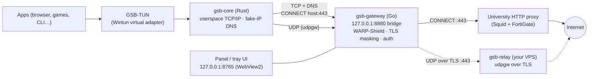

# GSB Wi-Fi Proxy Launcher

**[English](#gsb-wi-fi-proxy-launcher) · [Türkçe](#türkçe)**

A Windows (and Linux) tray app that routes a PC's traffic through a **university HTTP proxy**
on a filtered campus/dorm (GSB/KYK) Wi-Fi, using the user's **own** proxy account.
It brings up a virtual network adapter (**GSB-TUN**) so that all **TCP** and **DNS**
— and optionally **UDP** via a self-hosted relay — flow through one secure tunnel,
instead of only a browser's HTTP proxy setting.

> ⚠️ **Disclaimer.** This is a personal tool, for use with your **own** university
> account and your **own** server. Bypassing network filters/restrictions, defeating
> DPI, **tunneling UDP through an external relay** that the proxy does not allow, or
> hiding traffic may violate the relevant institution's Acceptable Use Policy and can
> lead to account suspension or disciplinary action. Enabling the spoofing, UDP relay
> and tunneling features is entirely at the user's discretion and risk. It does
> **not** cover someone else's accounts or any unauthorized access.

---

## How it works

The campus proxy is an **HTTP `CONNECT` proxy** (Squid + FortiGate) that only allows
`CONNECT` to port **443**. It carries TCP but not UDP, and applies the institution's
filtering. This tool terminates a local userspace TCP/IP stack behind a Wintun
adapter and forwards everything through that proxy with the user's credentials.



- **TCP** → `CONNECT host:port` through the proxy. Host names come from a local
  **fake-IP DNS**, so the real hostname reaches the proxy and the campus DNS filter
  is never consulted.
- **DNS** → answered locally with fake IPs (`198.18.0.0/15`); the real name is used
  in the subsequent `CONNECT`.
- **Plain HTTP (:80)** → the proxy refuses `CONNECT :80`, so it is re-sent as an
  ordinary absolute-URI proxied request (keep-alive).
- **UDP** → tunneled as **udpgw** frames over a TLS connection to a user-hosted
  **relay** on `:443` (because the proxy only allows `:443`). Without a relay, UDP is
  dropped and apps fall back to TCP.
- **WARP-Shield / TLS masking** → pre-warmed socket pool, DoH, header stripping, and
  a ClientHello record mutation that helps the real certificate pass DPI inspection.

## Components

| Path | Lang | Role |
|---|---|---|
| `gsb-gateway/control` | Go | Tray app, web panel (`:8765`), HTTP/`CONNECT` bridge (`:8880`), OS integration in `*_windows.go` / `*_linux.go` (TUN supervision, routes, system proxy, secret storage). Ships as a single `GSB_Gateway.exe` with the other pieces embedded. |
| `gsb-gateway/core` | Rust | Data plane: creates the TUN adapter (Wintun on Windows, `/dev/net/tun` on Linux) and terminates traffic in a userspace TCP/IP stack ([tun2proxy]/ipstack), forwarding to the bridge. |
| `gsb-gateway/relay` | Go | Optional UDP relay for a Linux VPS: TLS on `:443`, shared-token auth, udpgw forwarding. |
| `ui.html` | HTML | The panel, embedded into the exe and served locally. |

See [`gsb-gateway/docs/BEHAVIOR.md`](gsb-gateway/docs/BEHAVIOR.md) for the detailed
behavior and the HTTP API.

## Build

Requirements: Windows, **Go 1.26+**, **Rust** (stable), and the WebView2 runtime
(present by default on Windows 10/11).

```powershell
powershell -ExecutionPolicy Bypass -File gsb-gateway\build.ps1
```

This compiles the Rust core, stages it plus the signed `wintun.dll` and the proxy
list into `gsb-gateway\control\embedded\`, generates the app icon, builds a single
`GSB_Gateway.exe`, and assembles `dist\` + `GSB_Gateway.zip`.

> The committed `embedded/gsb-core.exe` and `embedded/wintun.dll` are empty
> placeholders so `go build` compiles on a fresh clone; `build.ps1` fills them with
> the real binaries. See [`gsb-gateway/control/embedded/README.md`](gsb-gateway/control/embedded/README.md).

## Usage

1. Run `GSB_Gateway.exe` — it lives in the system tray (shield icon). **Left-click**
   opens a small preview flyout next to the tray (status, speed graph, TUN and
   system-proxy switches); **Open detailed panel** there opens the full panel window.
   **Right-click** shows the menu.
2. Enter your university proxy username/password and pick a proxy, then **Save & Connect**.
3. To route traffic choose **System Proxy** (browsers) or **Virtual Adapter / TUN**
   (whole system, incl. UDP via the relay). TUN needs administrator rights.
4. **Force traffic through TUN** keeps Windows from falling back to bare Wi-Fi while
   the tunnel is up.

Settings (credentials are DPAPI-encrypted), the proxy list, usage counters and logs
live in `%APPDATA%\GSB Gateway\`. Nothing sensitive is stored next to the exe.
See [`config.example.json`](config.example.json) for the config shape.

## Linux

The same app runs on Linux (x86_64; systemd distros with NetworkManager and
systemd-resolved). Download `GSB_Gateway-linux-amd64.tar.gz` from the releases, then:

```bash
tar xzf GSB_Gateway-linux-amd64.tar.gz && cd GSB_Gateway && ./install.sh
```

Differences from Windows:

- Only the TUN engine (`gsb-core`) runs privileged, started through **pkexec** (the
  desktop's password prompt); the panel and tray stay unprivileged.
- Routes go through iproute2; sockets bound to the Wi-Fi address leave via the Wi-Fi
  gateway (policy rule), and with systemd-resolved all DNS is pointed at the tunnel.
- **System Proxy** sets GNOME (`gsettings`), KDE (`kioslaverc`) and `HTTP_PROXY` & co.
  via `~/.config/environment.d/`.
- Secrets are sealed with AES-GCM under `~/.config/gsb-gateway/secret.key` (weaker
  than DPAPI: the key file sits next to the config). **Force traffic through TUN**
  and WireSock are Windows-only.
- The panel opens as a Chromium/Chrome/Edge/Brave app window, else in the default
  browser. On GNOME the tray icon needs the AppIndicator extension.

Build on Linux with Go 1.26+, Rust, the musl target and `musl-tools` (static core):

```bash
rustup target add x86_64-unknown-linux-musl
bash gsb-gateway/build-linux.sh   # -> dist-linux/ + GSB_Gateway-linux-amd64.tar.gz
```

## UDP relay (optional)

To carry UDP (voice, games, QUIC), run `gsb-relay` on a Linux server you control; it
must listen on **:443** because the proxy only allows `CONNECT :443`.

```bash
# on the server (from the built dist\server\ artifacts)
sudo install -m0755 gsb-relay /usr/local/bin/gsb-relay
sudo install -m0644 gsb-relay.service /etc/systemd/system/gsb-relay.service
sudo systemctl daemon-reload && sudo systemctl enable --now gsb-relay
# read the generated token + certificate SHA-256 to enter in the panel:
journalctl -u gsb-relay --no-pager | head
sudo cat /var/lib/private/gsb-relay/token
```

The relay authenticates clients with a shared token and pins its self-signed
certificate by SHA-256 fingerprint; by default it refuses private/loopback UDP
destinations.

## Security & privacy notes

- Passwords and the relay token are encrypted at rest with Windows **DPAPI** (bound
  to your user account); the panel is bound to `127.0.0.1` and rejects cross-origin
  requests.
- The proxy still sees the **destination** (IP, or hostname unless IP-connect mode is
  on) and the data volume; it does not see HTTPS contents except on domains the
  institution actively MITM-inspects. DNS lookups are hidden from the campus resolver.
- A single heavy encrypted flow to one datacenter IP (the relay) is itself a clear
  sign that a tunnel is in use.

## License

Licensed under the **Apache License 2.0** — see [LICENSE](LICENSE).

---

# Türkçe

Filtreli bir kampüs/yurt (GSB/KYK) Wi-Fi ağında, kullanıcının **kendi** üniversite
proxy hesabıyla, bilgisayarın trafiğini bir **üniversite HTTP proxy'si** üzerinden
yönlendiren bir Windows (ve Linux) tepsi (tray) uygulaması. Sanal bir ağ bağdaştırıcısı
(**GSB-TUN**) oluşturur; böylece yalnızca tarayıcının proxy ayarı değil, tüm **TCP**
ve **DNS** — ve isteğe bağlı olarak kendi sunucunuzdaki bir röle ile **UDP** — tek bir
güvenli tünelden akar.

> ⚠️ **Sorumluluk Reddi.** Bu araç; kullanıcının **kendi** üniversite hesabı ve
> **kendi** sunucusuyla kişisel kullanım içindir. Ağ filtrelerini/kısıtlamalarını
> atlatmak, DPI'ı aşmak, proxy'nin izin vermediği **UDP trafiğini harici bir röle
> üzerinden tünellemek** veya trafiği gizlemek ilgili kurumun ağ kullanım politikasına
> (AUP) aykırı olabilir ve hesabın askıya alınması dâhil disiplin sonuçları doğurabilir.
> Spoofing, UDP rölesi ve tünelleme özelliklerini kullanmak tamamen kullanıcının
> inisiyatifindedir; her türlü sorumluluk kullanıcıya aittir. Başkasına ait hesapları
> veya izinsiz erişimi kapsamaz.

### Nasıl çalışır

Kampüs proxy'si yalnızca **443 portuna `CONNECT`** izni veren bir HTTP proxy'sidir
(Squid + FortiGate); TCP taşır, UDP taşımaz ve kurumun filtresini uygular. Bu araç,
Wintun adaptörünün arkasında yerel bir TCP/IP yığını çalıştırıp her şeyi kullanıcının
kimlik bilgileriyle bu proxy'den geçirir. Mimari şema için yukarıdaki İngilizce
bölümdeki diyagrama bakın.

- **TCP** → proxy üzerinden `CONNECT host:port`. Alan adları yerel **sahte-IP DNS**'ten
  gelir; gerçek ad proxy'ye iletilir, kampüs DNS filtresi devreye girmez.
- **DNS** → yerel olarak sahte IP'lerle (`198.18.0.0/15`) yanıtlanır.
- **Düz HTTP (:80)** → proxy `CONNECT :80`'i reddettiği için normal proxy isteğine çevrilir.
- **UDP** → `:443`'te çalışan, kullanıcıya ait bir **röleye** TLS üzerinden **udpgw**
  çerçeveleri olarak tünellenir. Röle yoksa UDP düşürülür.
- **WARP-Shield / TLS maskeleme** → ön-ısıtmalı soket havuzu, DoH, başlık temizleme ve
  DPI'ı atlatmaya yardımcı ClientHello maskelemesi.

### Derleme

Gereksinimler: Windows, **Go 1.26+**, **Rust** (stable) ve WebView2 çalışma zamanı
(Windows 10/11'de varsayılan gelir).

```powershell
powershell -ExecutionPolicy Bypass -File gsb-gateway\build.ps1
```

Bu komut; Rust çekirdeğini derler, onu + imzalı `wintun.dll`'i + proxy listesini
`gsb-gateway\control\embedded\` altına yerleştirir, ikonu üretir, **tek parça**
`GSB_Gateway.exe` üretir ve `dist\` + `GSB_Gateway.zip` hazırlar.

### Kullanım

1. `GSB_Gateway.exe`'yi çalıştırın — sistem tepsisinde (kalkan simgesi) durur. **Sol
   tık** tepsinin yanında küçük bir önizleme açar (durum, hız grafiği, TUN ve sistem
   proxy anahtarları); oradaki **Detaylı Paneli Aç** geniş paneli açar. **Sağ tık** menü.
2. Üniversite proxy kullanıcı adı/şifrenizi girip bir proxy seçin, **Kaydet ve Bağlan**.
3. Trafiği yönlendirmek için **Sistem Proxy** (tarayıcılar) veya **Sanal Adaptör / TUN**
   (tüm sistem, UDP dâhil) seçin. TUN yönetici izni ister.
4. **Trafiği TUN'a Zorla**, tünel açıkken Windows'un Wi-Fi'ye düşmesini engeller.

Ayarlar (şifreler DPAPI ile şifreli), proxy listesi, kullanım sayaçları ve loglar
`%APPDATA%\GSB Gateway\` altında tutulur; exe'nin yanına hassas bir şey yazılmaz.

### Linux

Aynı uygulama Linux'ta da çalışır (x86_64; systemd + NetworkManager +
systemd-resolved). Sürümlerden `GSB_Gateway-linux-amd64.tar.gz`'yi indirin:

```bash
tar xzf GSB_Gateway-linux-amd64.tar.gz && cd GSB_Gateway && ./install.sh
```

- Yalnızca TUN motoru (`gsb-core`) yetkiyle çalışır; **pkexec** parola penceresi
  açılır. Panel ve tepsi normal kullanıcıda kalır.
- **Sistem Proxy**; GNOME, KDE ve `~/.config/environment.d/` (HTTP_PROXY) ayarlarını yapar.
- Şifreler `~/.config/gsb-gateway/secret.key` ile AES-GCM şifrelenir (DPAPI kadar
  güçlü değildir). **Trafiği TUN'a Zorla** ve WireSock yalnızca Windows içindir.
- Derleme: `bash gsb-gateway/build-linux.sh` (Go, Rust, musl hedefi ve `musl-tools`).

### UDP rölesi (isteğe bağlı)

Sesli arama/oyun/QUIC gibi UDP trafiğini taşımak için kendi Linux sunucunuzda
`gsb-relay`'i çalıştırın; proxy yalnızca `CONNECT :443`'e izin verdiği için **:443**'te
dinlemelidir. Kurulum adımları yukarıdaki İngilizce bölümdedir. Röle, istemcileri
paylaşılan bir token ile doğrular ve sertifikasını SHA-256 parmak iziyle sabitler.

### Lisans

**Apache License 2.0** — bkz. [LICENSE](LICENSE).
